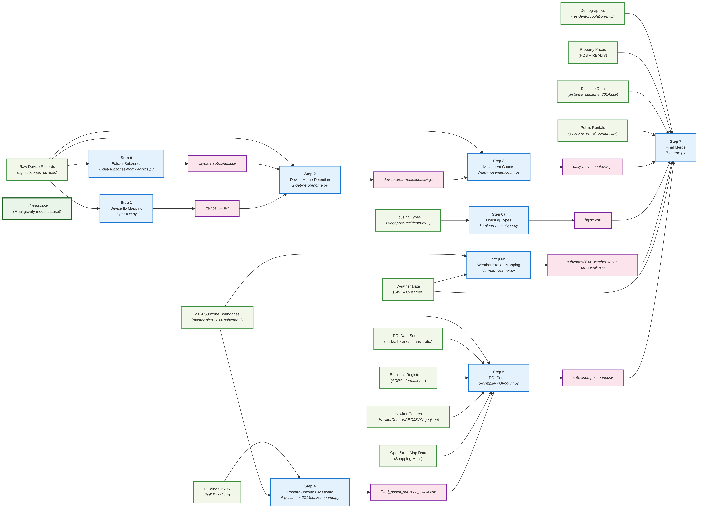

# 📦 Neighborhood Mismatch and Visits

This study combines GPS traces with census and housing microtransactions to examine how socioeconomic mismatches shape daily movements in Singapore.
We measure mismatch as a difference in neighborhood price levels or ethnic composition.
Decomposing mismatch into its directional components reveals stark asymmetries.
Affluence-based segregation is driven by a lack of visits from higher- to lower-priced neighborhoods, while ethnic-based segregation is driven by a lack of visits from majority-ethnic to minority-ethnic neighborhoods.
These asymmetries concentrate in central and peripheral destinations, respectively.
Taking the ethnic estimates to a two-town counterfactual analysis of the Ethnic Integration Policy shows that ignoring directional asymmetries—revealed by the large-scale behavioral traces—understates the policy’s effect on cross-neighborhood flows by a factor of three.

> Lim, Jing Zhi, and Lucas Shen. Forthcoming. "Neighborhood Mismatch and Visits." *Regional Science and Urban Economics*.

[](https://github.com/LSYS/nbhmv/actions/workflows/pylint.yml)
[](https://github.com/LSYS/nbhmv/actions/workflows/nblint.yml)
[](https://github.com/LSYS/nbhmv/actions/workflows/nblint-geo.yml)

## 📂 Repo Structure and Scripts

```bash
.
├── analysis
│  ├── code
│  ├── logs
│  ├── cd-panel.csv
│  ├── main.do
│  └── readme.md
├── assets
│  ├── build-pipeline.mmd
│  ├── build-pipeline.png
│  ├── build-pipeline.svg
│  ├── requirements-stata.txt
│  └── requirements.txt
├── build
│  ├── aux-notebooks
│  ├── intermediate-output
│  ├── logs
│  ├── preprocessed-data
│  ├── raw-data
│  ├── tests
│  ├── 0-get-subzones-from-records.ipynb
│  ├── 1-get-IDs.ipynb
│  ├── 2-get-devicehome.ipynb
│  ├── 3-get-movementcount.ipynb
│  ├── 4-postal_to_2014subzonename.ipynb
│  ├── 5-compile-POI-count.ipynb
│  ├── 6a-clean-housetype.ipynb
│  ├── 6b-map-weather.ipynb
│  ├── 7-merge.ipynb
│  ├── cd-panel.csv
│  ├── Makefile
│  ├── readme.md
│  └── utilities.py
├── geo
│  ├── logs
│  ├── out
│  ├── bootstrap-r2.ipynb
│  ├── borders.ipynb
│  ├── choropleth-devices.ipynb
│  ├── choropleth-income.ipynb
│  ├── choropleth-price.ipynb
│  ├── get-devicecount-subzone-day.ipynb
│  ├── Makefile
│  ├── pa-price.ipynb
│  ├── ping-variation.ipynb
│  ├── regplot_wpsm_income_pa.do
│  └── utilities.py -> ../build/utilities.py
├── results
│  ├── figures
│  ├── tables
│  └── README.md
├── .gitignore
├── LICENSE
├── Makefile
└── README.md
```

## 🔧 Build


Set up the `venv` using 

```bash
make setup
```

which uses dependencies listed in [`requirements.txt`](https://github.com/LSYS/nbhmv/blob/main/assets/requirements.txt).

To build the complete dataset:



```bash
make data
```

using the [`Makefile`](https://github.com/LSYS/nbhmv/blob/main/build/Makefile) and [`runpynb`](https://pypi.org/project/runpynb/) to execute relevant notebooks in sequence in the `venv`.


See [`./build`](https://github.com/LSYS/nbhmv/tree/main/build) for more details.


## 📊 Analysis

`ssc` dependencies are listed in a [requirements-stata.txt](https://github.com/LSYS/nbhmv/blob/main/assets/requirements-stata.txt) and custom dependencies are in [`./analysis/code/ado`](https://github.com/LSYS/nbhmv/tree/main/analysis/code/ado).

## Citations

We use [RetractionWatch](https://gitlab.com/crossref/retraction-watch-data) (via [Actions](https://github.com/marketplace/actions/retracted-articles-checker)) to periodically check for retracted citations.

[](https://github.com/LSYS/nbhmv/actions/workflows/retraction_checker.yml)

If this work is useful to you, please consider citing:
> Lim, Jing Zhi, and Lucas Shen. Forthcoming. "Neighborhood Mismatch and Visits." *Regional Science and Urban Economics*.

**BibTeX:**
```bibtex
@article{nbhmv,
  author  = {Lim, Jing Zhi and Shen, Lucas},
  title   = {Neighborhood Mismatch and Visits},
  journal = {Regional Science and Urban Economics},
  note    = {Forthcoming},
  year    = {2026},
  url     = {https://www.lucasshen.com/research/nbh-mismatch-visits.pdf}
}
```
