## Key Results

### Figure 1

<table>
  <tr>
    <td></td>
    <td></td>
  </tr>
  <tr>
    <td></td>
    <td></td>
  </tr>
</table>

### Figure 2

<table>
  <tr>
    <td></td>
    <td></td>
  </tr>
</table>

### Figure 3
<table>
  <tr>
    <td rowspan="2" width="60%">
       
      <b>Figure 1: Main figure description</b>
    </td>
    <td width="40%">
       
      <b>Figure 2a: Top subfigure</b>
    </td>
  </tr>
  <tr>
    <td>
       
      <b>Figure 2b: Bottom subfigure</b>
    </td>
  </tr>
</table>

### Figure 4

<table>
  <tr>
    <td>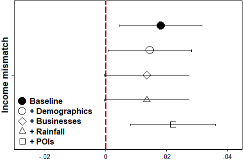</td>
    <td>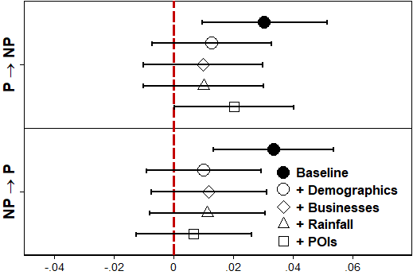</td>
  </tr>
</table>

### Figure 5

<table>
  <tr>
    <td></td>
    <td></td>
  </tr>
</table>

### Figure 6

<table>
  <tr>
    <td>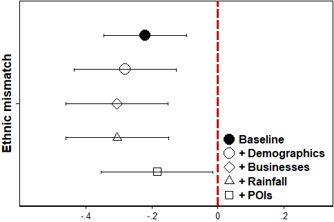</td>
    <td>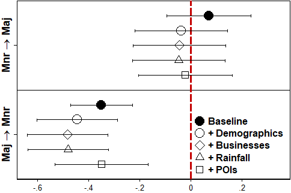</td>
  </tr>
</table>

### Figure 7
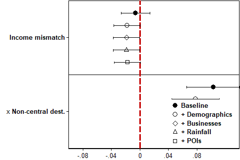

### Figure 8
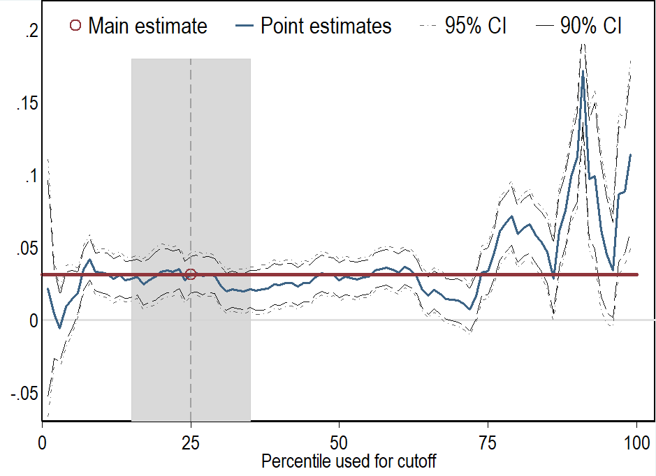

### Figure 9

<table>
  <tr>
    <td>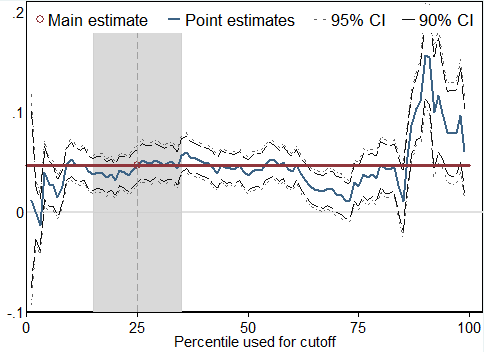</td>
    <td>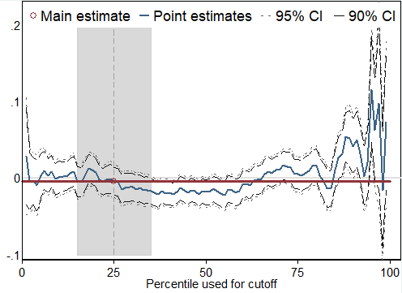</td>
  </tr>
</table>

### Figure 10

<table>
  <tr>
    <td>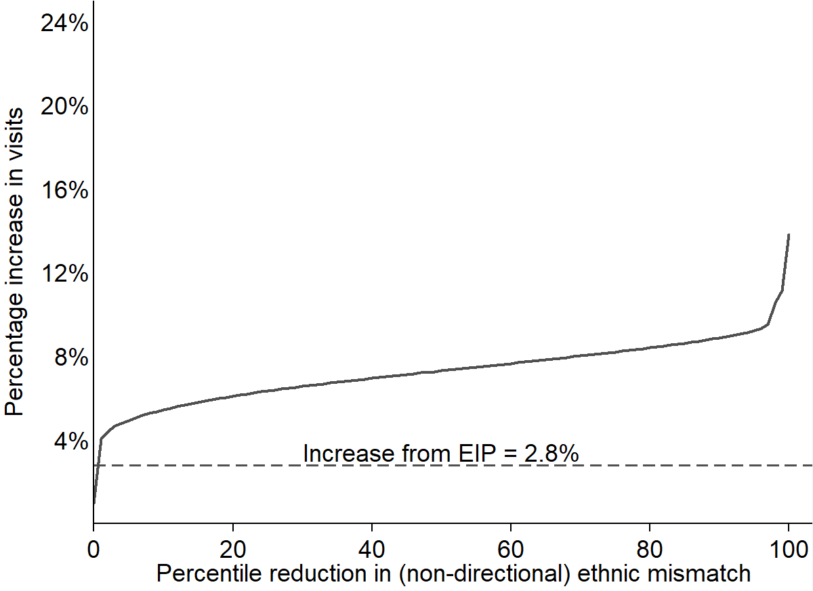</td>
    <td>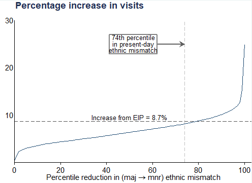</td>
  </tr>
</table>

## Supplementary Results

### Figure A3
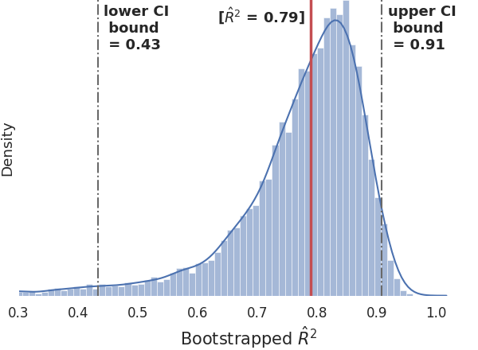

### Figure A4
<table>
  <tr>
    <td>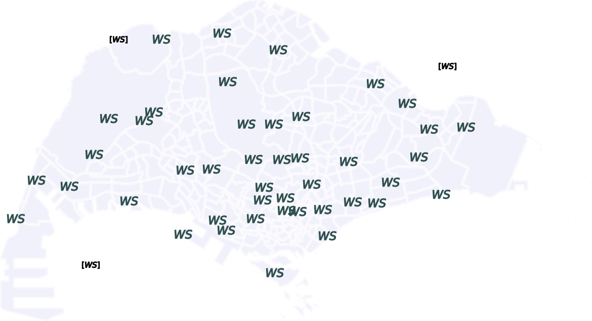</td>
    <td>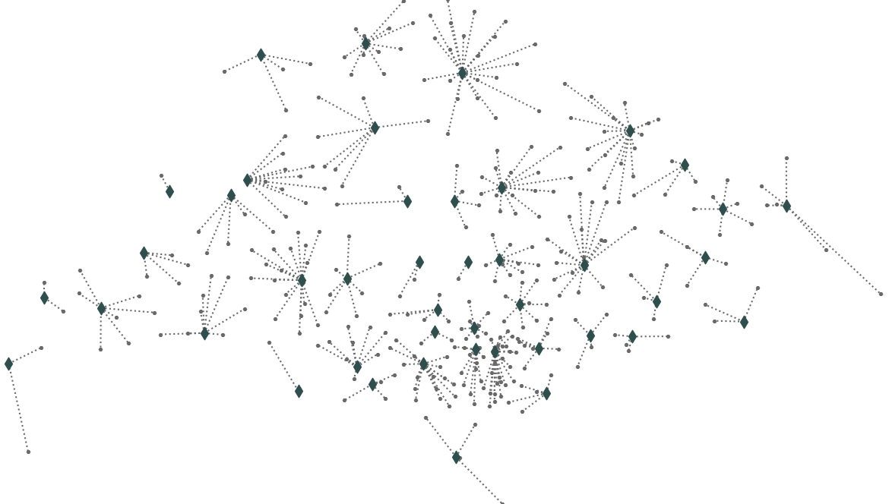</td>
  </tr>
</table>

### Figure D1

<table>
  <tr>
    <td>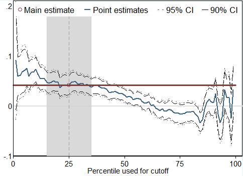</td>
    <td>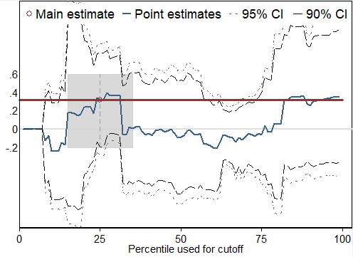</td>
  </tr>
</table>

### Figure D2
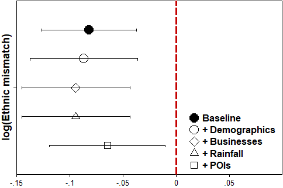

### Figure D3
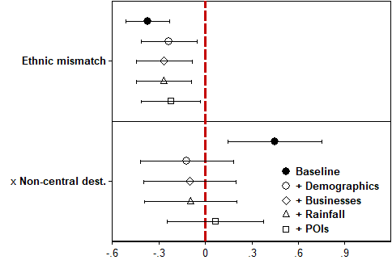

### Figure E1
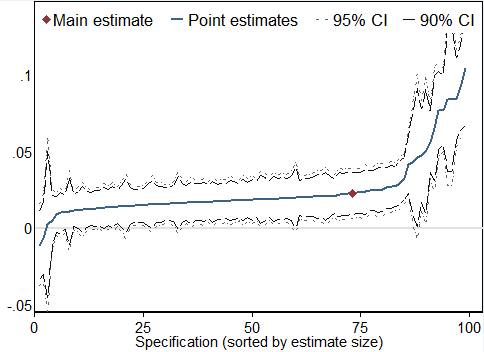

### Figure E2

<table>
  <tr>
    <td>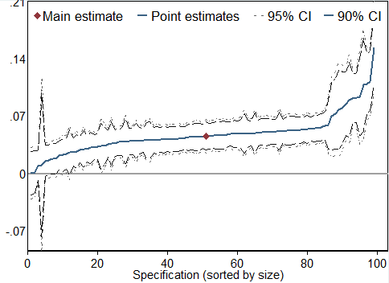</td>
    <td>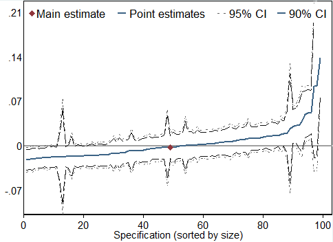</td>
  </tr>
</table>

### Figure E3

<table>
  <tr>
    <td></td>
    <td></td>
  </tr>
</table>
