## Key Results

### Figure 1

<table>
  <tr>
    <td>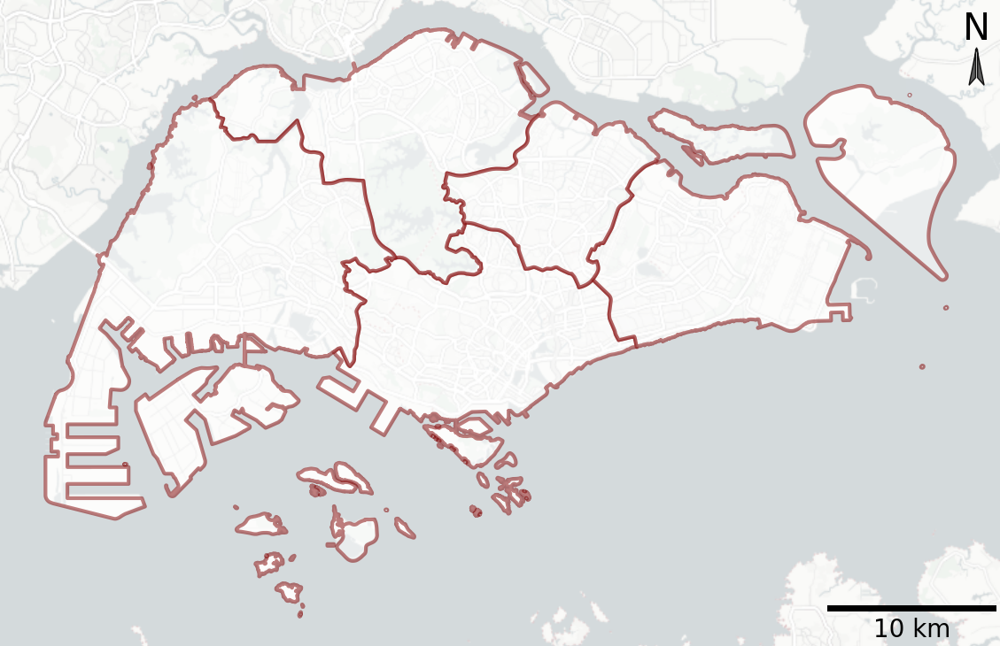</td>
    <td>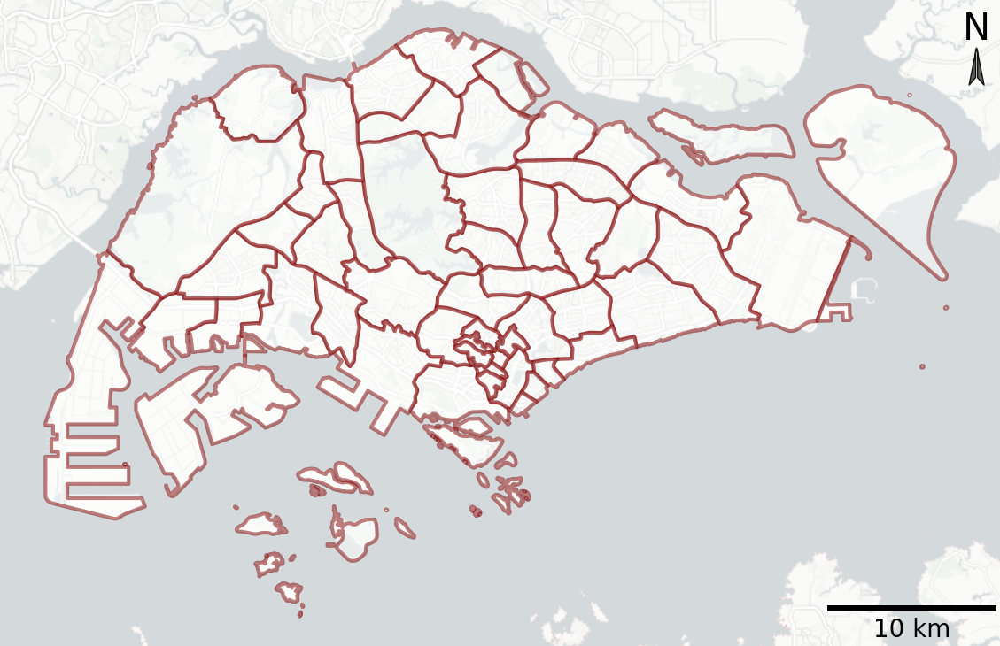</td>
  </tr>
  <tr>
    <td>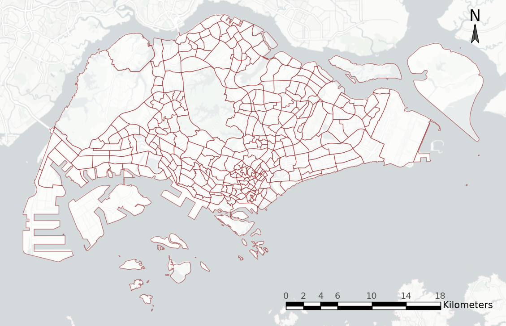</td>
    <td>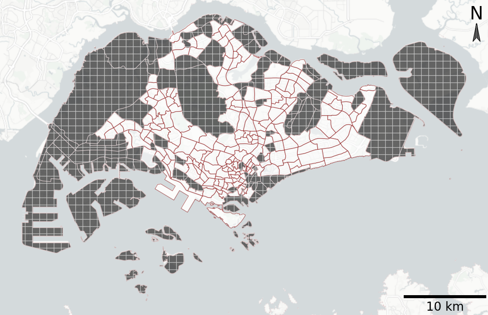</td>
  </tr>
</table>

### Figure 2

<table>
  <tr>
    <td>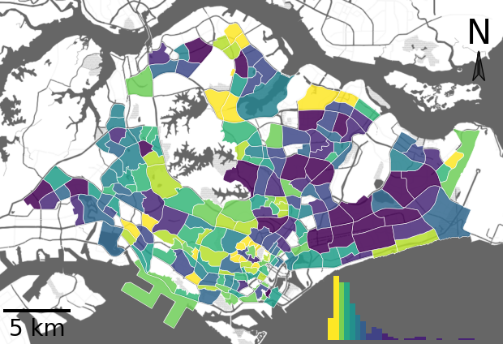</td>
    <td>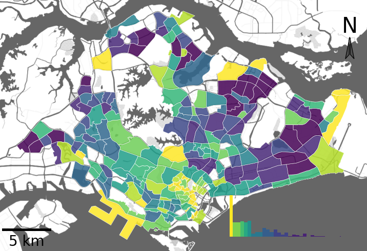</td>
  </tr>
</table>

### Figure 3
<table>
  <tr>
    <td rowspan="2" width="55%">
      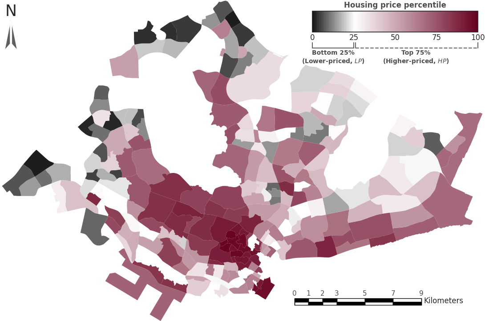 
      <b>House prices</b>
    </td>
    <td width="45%">
      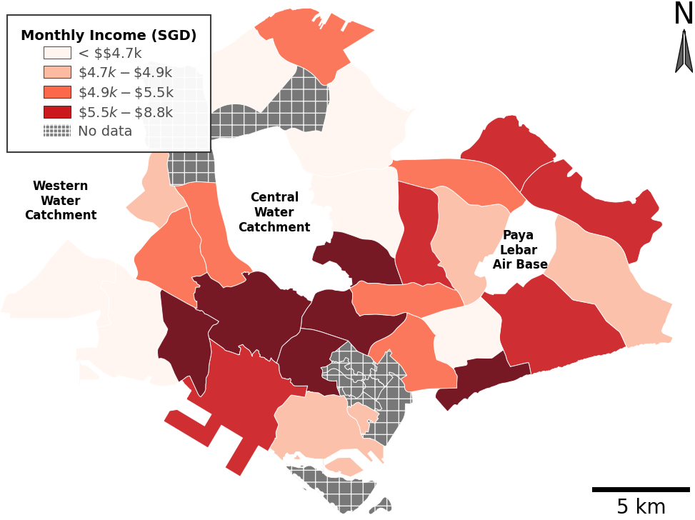 
      <b>Monthly income</b>
    </td>
  </tr>
  <tr>
    <td>
      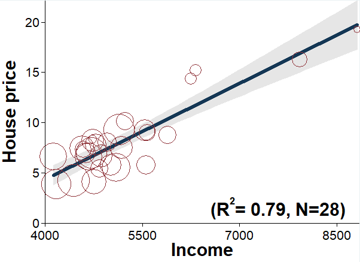 
      <b>Correlation</b>
    </td>
  </tr>
</table>

### Figure 4

<table>
  <tr>
    <td></td>
    <td></td>
  </tr>
</table>

### Figure 5

<table>
  <tr>
    <td>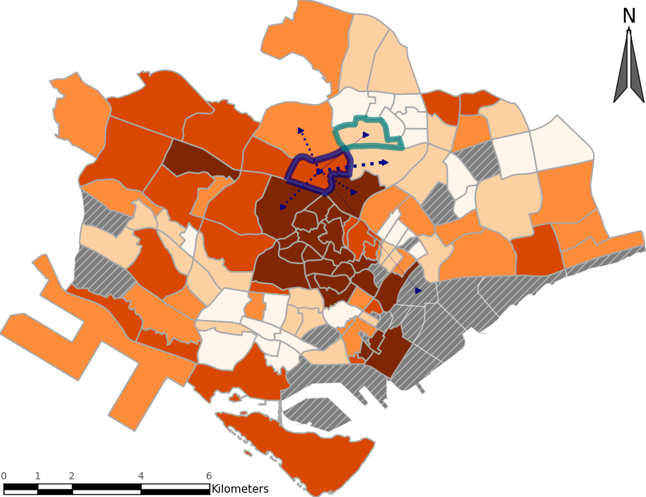</td>
    <td>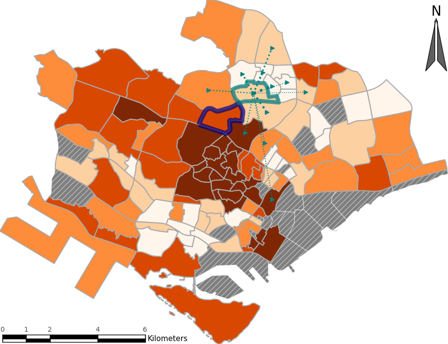</td>
  </tr>
</table>

### Figure 6

<table>
  <tr>
    <td></td>
    <td></td>
  </tr>
</table>

### Figure 7

### Figure 8

### Figure 9

<table>
  <tr>
    <td></td>
    <td></td>
  </tr>
</table>

### Figure 10

<table>
  <tr>
    <td></td>
    <td></td>
  </tr>
</table>

## Supplementary Results

### Figure A3

### Figure A4
<table>
  <tr>
    <td></td>
    <td></td>
  </tr>
</table>

### Figure D1

<table>
  <tr>
    <td>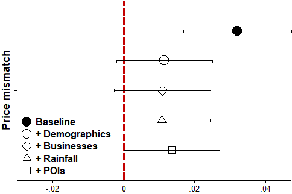</td>
    <td>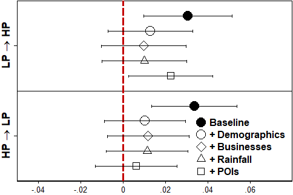</td>
  </tr>
</table>

### Figure D2
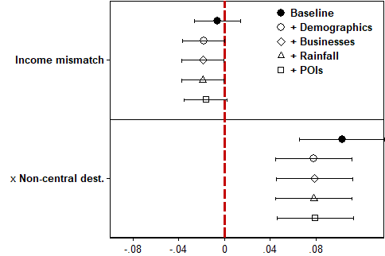

### Figure E1

<table>
  <tr>
    <td></td>
    <td></td>
  </tr>
</table>

### Figure E2

### Figure F1

### Figure F2

<table>
  <tr>
    <td></td>
    <td></td>
  </tr>
</table>

### Figure F3

<table>
  <tr>
    <td>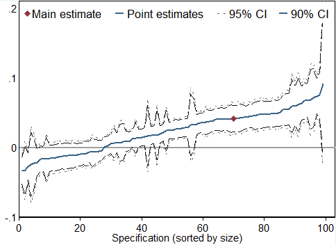</td>
    <td>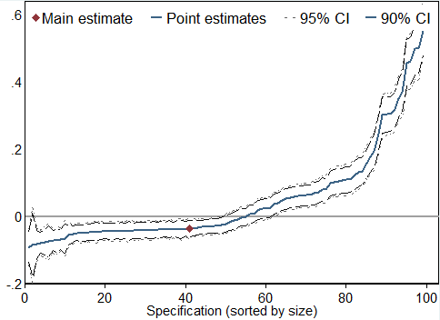</td>
  </tr>
</table>
